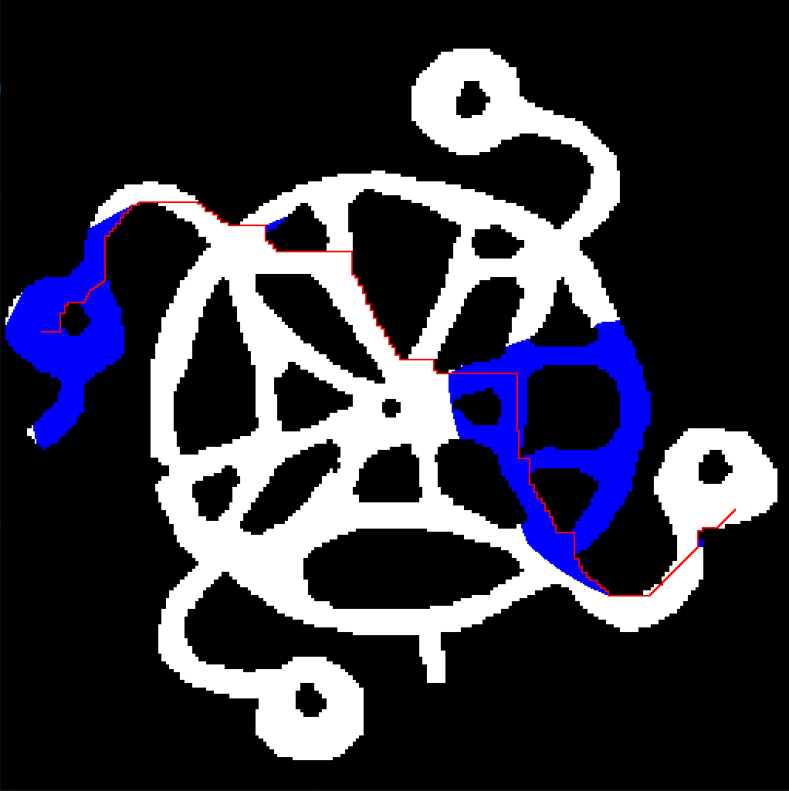
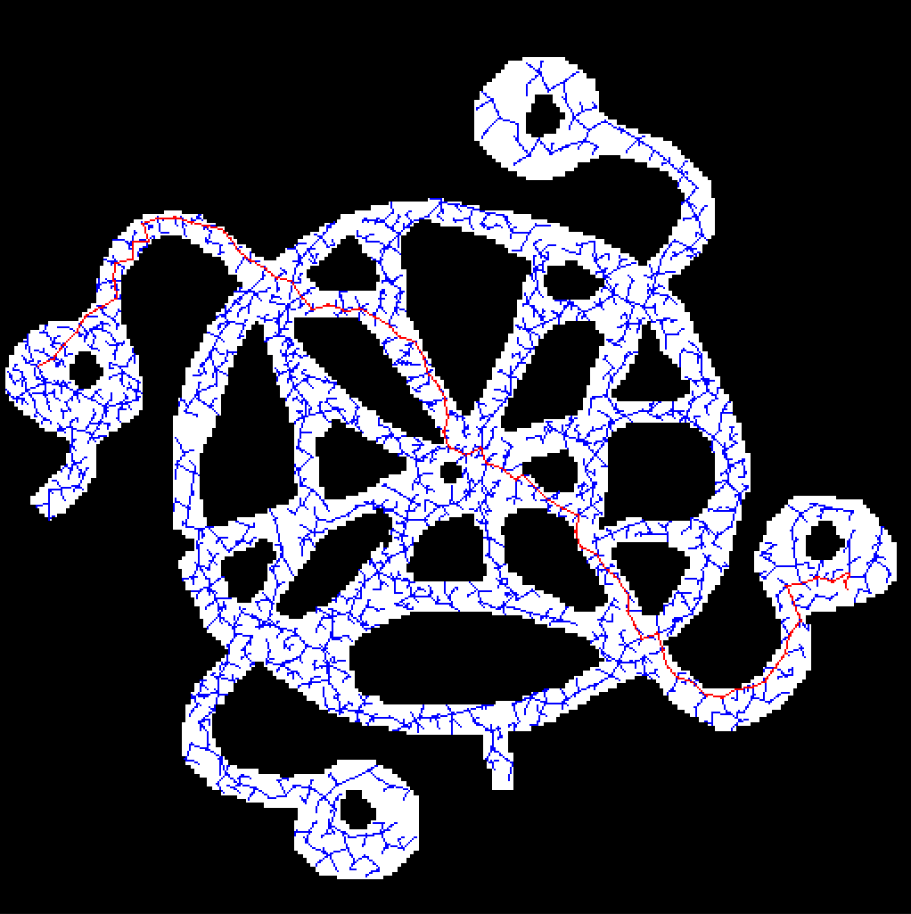
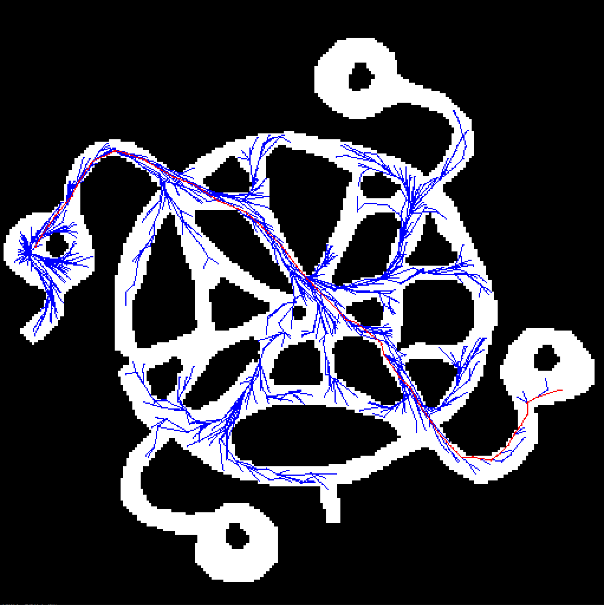

# 2D Pathfinding Algorithms

This project is consist of A*, Breadth-First Search, Depth-First Search, RRT (Rapidly exploring random tree) and RRT* algorithms.

**Try it in the browser: [bilalkah.github.io/path-planning](https://bilalkah.github.io/path-planning/)**. The page runs these C++ planners, compiled to WebAssembly.

## File Structure

```
path-planning/
├── CMakeLists.txt
├── config/
│   └── main.yaml
├── docker
├── maps/..
├── planning/
│   ├── CmakeLists.txt
│   ├── grid_base
│   │   ├── CmakeLists.txt
│   │   ├── /..
│   │   ├── bfs/..
│   │   └── dfs/..
│   └── tree_base
│   │   ├── CmakeLists.txt
│   │   ├── rrt/..
│   │   └── rrt_star/..
├── site/          # project page (GitHub Pages)
├── test/..
├── third-party/
│   └── yaml-cpp/..
├── tools/..
├── web/           # WebAssembly bindings and build script

```

## Requirements
``` bash
sudo apt-get install libsfml-dev
```

## Run with Docker
```bash
git clone --recurse-submodules https://github.com/bilalkah/path-planning.git
cd path-planning/docker

# build Docker image
bash build.sh

# create container
bash run.sh

# after creating container run sample demo
cd path-planning/build && ./main
```

## Web demo

`site/` is the project page. `web/planner_bindings.cpp` exposes the planners
to JavaScript with Embind, and `web/build.sh` compiles them to WebAssembly
with Emscripten and copies the maps next to the page:

```bash
source /path/to/emsdk/emsdk_env.sh
./web/build.sh
python3 -m http.server --directory site   # then open http://localhost:8000
```

`.github/workflows/pages.yml` runs the same build and publishes `site/` to
GitHub Pages.

## Coloring

```
Free: White
Visited: Blue
Occupied: Black
Start: Green
Goal: Yellow
Path: Red
```

## Grid Based

### A Star



### BFS


## Tree Based

### RRT



### RRT Star


